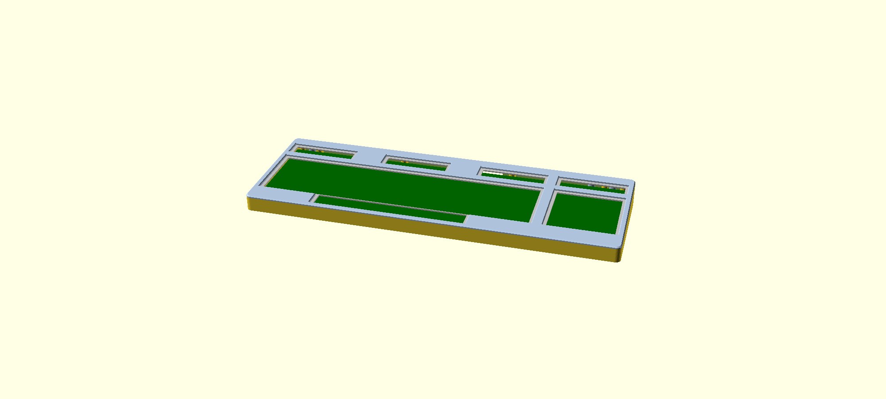

# Printable case for the C128D / DCR external keyboard

A four-piece printed enclosure that turns the plate + PCB from this project into a
stand-alone keyboard for a 128D/DCR whose original keyboard has gone missing.  It is a
functional case, not a replica of the Commodore housing.

Everything is generated from [`c128d_case.scad`](c128d_case.scad).  Ready-to-slice STLs
are in [`stl/`](stl/); run `make` to regenerate them after changing parameters.



## How it goes together

```
                 bezel (top frame, 2 halves, butt joint at x=30)
   ┌──────────────────────────────────────────-──────────────┐
   │  ┌──────────────── keycaps ────────────────┐            │
   │  │  plate (1.5 mm steel, sits on bosses)   │  4 plate   │  <- wafer-head screws sit in
   │  │  switches / PCB                         │  screws    │     pockets under the bezel
   └──┴─────────────────────────────────────────┴────────────┘
                 tray (bottom, 2 halves, lap joint at x=-5)
```

* The plate rests on six 7 mm bosses (its four rear M3 holes and two front-corner M3 holes)
  plus thin ledges under its front and side edges.  Two 4.6 mm pins at the rear corners drop
  into the plate's Ø5 locating holes.  Only the four rear holes get screws; the front corners
  sit on pins and are clamped by the bezel.
* Four snap tabs on the bezel's front skirt click into pockets in the tray's front wall (see
  *Front snap hooks* below); press the front edge down until they click, lift firmly to release.
* The bezel has seven columns hanging from its underside.  Five pass through the slots and
  notches already cut in the plate's rear edge and two pass through the Ø6.5 holes in the
  front corners.  All seven are screwed from underneath through the floor, so no fasteners
  are visible from above.
* The four plate screws use wafer / ultra-low-profile heads (≤ 0.9 mm tall) which sit in
  0.9 mm pockets in the bezel underside, so the bezel top is one flat plane and prints
  face-down without supports.  A 1.2 mm skirt drops into the 2 mm gap between the plate edge
  and the wall to register the bezel to the tray.
* The tray halves interlock with a lap joint (outer half of the front/rear walls + upper half
  of the floor).  The bezel halves meet on a 45° scarf: the left half's top surface rides
  2.6 mm over the right half on a sloped face that is also the glue surface, and the left
  half's skirt runs 8 mm past the joint underneath so the halves key together while a bead of
  CA or epoxy on the slope sets.  Both halves still print face-down without supports (the
  slope is exactly 45°).  The two split lines are staggered by 35 mm so each bezel half
  bridges the tray joint.  Once the plate is screwed down the
  steel plate is the structural spine — the printed parts just hang off it.
* The floor is tilted 5° relative to the plate, so the case is 18 mm tall at the front and
  31 mm at the rear.  Overall footprint is 410 x 147 mm.
* The rear wall has a standard DB25 panel-connector cutout (47.04 mm hole spacing) at
  x ≈ 43 mm, directly behind the FFC connector on the PCB.  Set `rear_port = "cable"` for a
  plain 9 mm grommet hole instead, or `"none"`.
* Six Ø12.5 x 1 mm recesses in the underside take common rubber bumper feet.

## Printing

All four parts fit a 256 x 256 mm bed (Bambu P2S / P1S / X1C) with room to spare:

| part | size (mm) | orientation |
|---|---|---|
| tray_left | 198 x 149 x 28 | as exported (floor down) |
| tray_right | 221 x 149 x 28 | as exported (floor down) |
| bezel_left | 232 x 147 x 29 | as exported (top face down) |
| bezel_right | 186 x 147 x 29 | as exported (top face down) |

The STLs are already in their print orientation.  Suggested settings: 0.2 mm layers,
4-5 walls, 25 % infill, PETG or ABS/ASA preferred over PLA for the tray (warping over a
220 mm part is the main risk — use a brim). I printed with PLA support material and PETG filament
on a textured plate, mostly because I don't have a smooth PETG plate.

## Hardware

| qty | item | where |
|---|---|---|
| 4 | M3 x 6 **wafer / ultra-low-profile head**, head ≤ 0.9 mm tall, ≤ 6 mm dia | plate → rear tray bosses.  A normal button/pan head is too tall; see `plate_screw_head_h` |
| 4 | M3 heat-set insert, Ø4 hole | rear tray bosses |
| 5 | M3 x 8 | floor → rear bezel columns |
| 5 | M3 heat-set insert, Ø4 hole | rear bezel columns |
| 2 | M3 x 8 | floor → front bezel columns (self-tapping into a 2.6 mm hole; the columns are only 6 mm dia) |
| 1 | DB25 panel-mount connector + 2 x 4-40 jack screws | rear wall |
| 6 | rubber bumper feet, ≤ 12 mm | underside |

Assembly order: fit inserts → join tray halves (drop the left half's tongue into the right
half's pocket; a drop of CA glue on the lap is optional) → lower the plate/PCB onto the pins
and bosses, fit the four rear wafer-head screws → route the cable → glue the two bezel halves
on the scarf (a thin bead on the slope, press together, wipe the squeeze-out from the top
face before it sets) → lay the bezel on, columns through the plate slots, press the front
until the four hooks click → seven screws from below → feet.

## Things to measure before you print

The bezel has one opening per key group, like the original C128 top case: the four top-row
groups, the main block (with the spacebar notch) and the numeric keypad.  Their outlines are
derived from the switch positions in the PCB, assuming caps are 19.05 mm per unit, with the
spacebar at 9u (`space_cap_w`).  `key_clear` (1.2 mm) is the gap between every cap edge and the
bezel.  Set `group_openings = false` for a single large opening instead.

The bezel top sits 2.9 mm above the plate.  Measured on a built
keyboard with original C128 caps on Outemu mid-low switches, the keycap skirts sit 6.3-7.2 mm
above the plate at rest and 3.8-4.6 mm when pressed, so there is over 1 mm of margin.  If you
use different caps or switches, check that and adjust `bezel_t` / `bezel_gap`.

## Parameters worth knowing

Everything is at the top of the `.scad`.  The ones you're most likely to touch:

* `tilt` — typing angle (0 works too).
* `under_pcb` — clearance under the PCB at the front wall; raise it if you need room for
  a cable adapter board.
* `tray_split_x`, `bezel_split_x` — move the joints; keep every half under ~250 mm (the
  left bezel half is `skirt_lap` longer than the split position suggests).
* `bezel_scarf`, `skirt_lap` — the bezel joint's slope and skirt stagger.  Leave the slope at
  45° unless you are happy to print the right half with supports.
* `rear_port`, `port_x` — connector style and position.
* `insert_d` — set to 2.6 to skip heat-set inserts and self-tap everything.

Preview a region of the assembled case with e.g.
`openscad -D 'crop=[-195,40,-130,90]' -D 'show=["tray"]' c128d_case.scad`.

## Front snap hooks

Nothing else fastens the bezel to the tray along the front edge between the two corner
columns, and the tray is only 18 mm tall there, so four snap hooks do it (`front_hooks`).
The bezel skirt grows into four cantilever tabs (10 x 1.2 mm, 11 mm long) that hang down
inside the front wall; a 45° catch on each tab's outer face snaps into a 1 mm blind pocket in
the wall, and the front ledge is relieved behind each tab so it can flex inward on the way in.
Two tabs sit either side of the tray lap joint on the same bezel half, so the bezel also pins
the two tray halves together.  Nothing shows on the outside, and a firm lift at the front
releases them (the catch's top face is set by `hook_release`).  Estimated bending strain is about 0.9 %, fine
for PETG and ASA; for PLA drop `hook_bump` to 0.6.

If the fit needs adjusting, the knobs are in the `.scad`; change, `make`, reprint the front
bezel half:

* won't snap in or needs too much force: raise `hook_clear` (0.25 -> 0.35) or lower `hook_bump`;
* loose or rattles: lower `hook_clear`, or raise `hook_bump` by 0.1;
* tab feels stiff or whitens: lengthen `hook_len` (up to ~11.5; the floor is 12.6 below the
  plate) or thin `hook_t` to 1.0;
* catch shears off: thicken `hook_t` to 1.4 and raise `hook_len` to keep the strain down;
* engages but never clicks, and holding force is marginal: two knobs, in this order.
  `hook_release` steepens the catch's top face (45 is symmetric and lifts off easily; 55 is
  the current setting; 60-70 holds much harder and still lifts off; 90 is permanent).
  `hook_guide = true` adds a rib behind each tab that only leaves it the room the catch
  needs, so the tab has to bend and snaps back instead of leaning away into the open cavity.
  The rib makes disassembly harder, so try the release angle first. I have not tried the hook_guide
  version as I feel like it would break when trying to disassemble.

Tab positions are `hook_x`; keep them off the tray lap joint (x -6..4) and the bezel split
(x = 30), and away from the front corner columns.


## Roadmap: toward the original look

I like the look of the original keyboard case, this one is a bit square. It does the job but I think
we could make it look a lot nicer. OG 128D keyboard (`docs/c128d-keyboard-reference.jpg`):

1. **Big soft edges.**  Vertical corner radius of 10 mm or more (now `corner_r = 6`) and a
   proper rounded top edge instead of the 1.2 mm chamfer.  Removes most of the "box" feel.
   Model work: a rounded-profile shell instead of the chamfered hull; still prints face down.
2. **Wide, sloped front deck.**  The original has a broad front bezel that falls away to a
   thin lip; ours is a narrow rim.  Extend tray and bezel forward 20 to 25 mm and slope the
   deck.  Footprint grows to about 435 x 170 mm, still fits the 256 mm bed.
3. **Rear brow.**  The case rises behind the function-key row and carries the model badge.
   Our plate is flat, so this is a taller rear bezel region that rises *behind* the top row,
   not over it, with a sloped transition (keep it under 45° so it still prints face down) and
   a recess on the right for a "commodore 128D" label. The we need badgeman to make us a badge.
4. **Shell seam.**  Turn the tray/bezel joint into a deliberate parting line: a small step
   at the seam and the tray walls drafted inward a few degrees below it, like the molded
   bottom shell. I am on the fence about this? Probably not worth it.
5. **Rear fold-out legs.**  The 128D keyboard's legs are at the rear and lift the back, like
   most keyboard feet, but they are mounted on the *sides* of the case rather than
   underneath, so they stay visible when folded.  They pivot up and down about a
   cross-axis pin like any keyboard foot.  Two printed legs on pin hinges in recesses in
   the rear side walls, with a detent.  New parts; the tilt parameter then becomes the
   "legs folded" angle. Currently this case is angled up because it has the db25 slot, so legs
   that lift it up would be a bit off.
6. **Color and finish.**  Warm beige or light gray filament. Polar filament has a nice retro shade:
   [Retro Platinum](https://polarfilament.com/products/open-beta-experimental-retro-platinum-petg-1kg-1-75mm)
